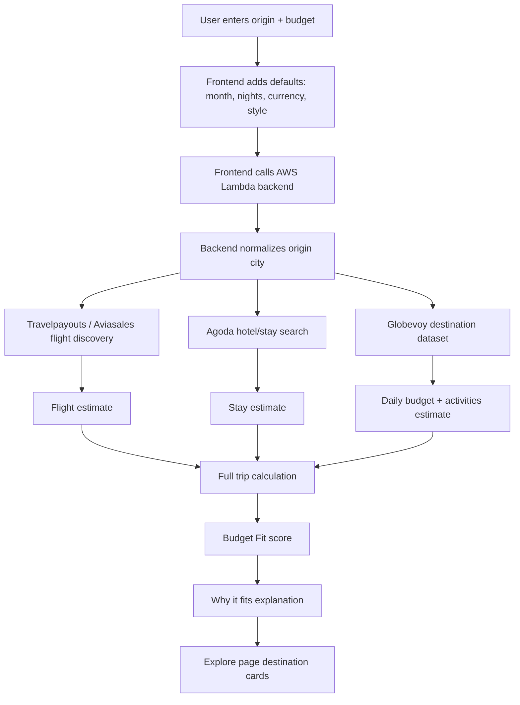
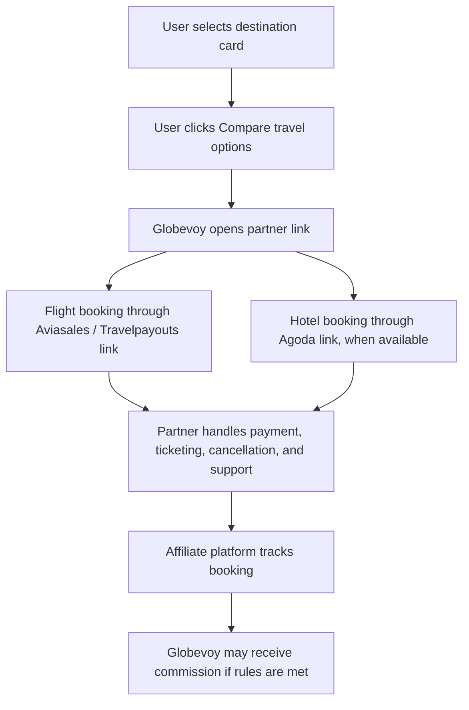
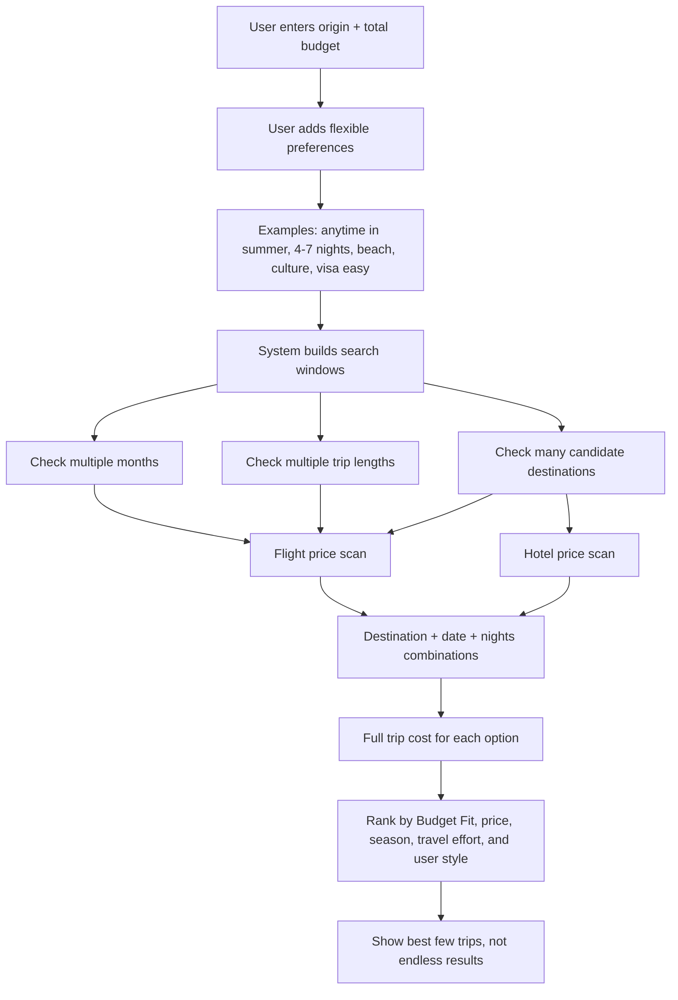
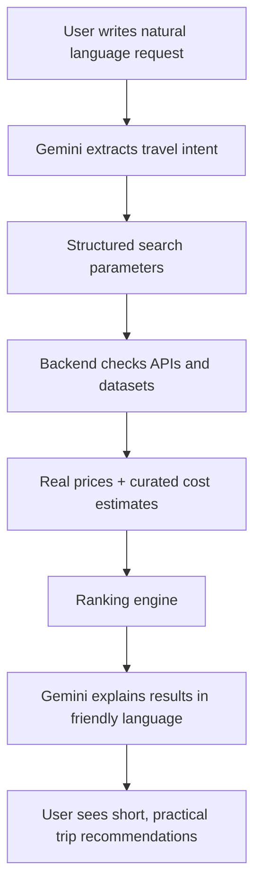
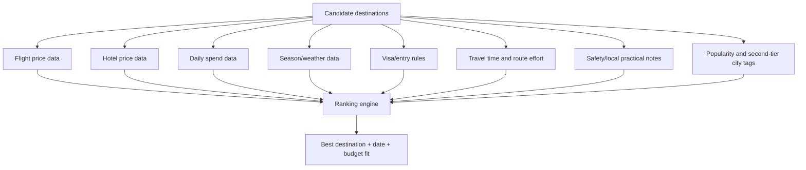

# Globevoy Backend Algorithm Flowcharts

Status: planning and explanation document for the current MVP and the next AI-assisted version.

Purpose: explain, in simple language, how Globevoy turns user input into travel recommendations, where booking/referral links fit, and how Gemini can improve the product without inventing prices.

## 1. Current MVP Backend Flow

The current MVP is a budget-first travel discovery flow. It is not a direct booking engine yet.



### Current Input

The user currently provides:

- origin city
- budget
- currency

The system currently adds or defaults:

- travel month
- nights
- passenger count, currently assumed as 1 adult
- trip style filter, optional

### Current Output

Each recommendation returns:

- destination
- estimated flight cost
- estimated stay cost
- daily budget estimate
- basic activity/local cost estimate
- full trip estimate
- remaining budget or over-budget gap
- Budget Fit score
- explanation of why the destination fits
- practical notes such as travel time, walkability, weather, local cost, and visa note

### Important MVP Detail

If Travelpayouts or Agoda fails, Globevoy does not crash. It falls back to curated estimates so users still see useful results.

## 2. Booking / Referral Flow

Globevoy currently recommends trips and sends users to partner sites. It does not complete bookings inside Globevoy yet.



### Current Booking Status

Current MVP:

- user can compare travel options through partner links
- partner handles the booking
- Globevoy does not process payment
- Globevoy does not issue tickets
- Globevoy does not manage cancellation or refunds

Later direct booking:

- would require a deeper booking API such as Duffel or another provider
- would require payment handling
- would require customer support
- would require cancellation/refund rules
- would create more legal and operational responsibility

For the MVP, referral booking is simpler and safer.

## 3. Future Flexible Date + Destination Flow

The current test flow still uses fixed/default values in some places. The future version should search across multiple destinations and date windows to find better trip packages.



### What Changes From The Current MVP

Current MVP:

- one month
- one trip length
- one set of recommendations

Future version:

- several months
- several trip lengths
- more candidate destinations
- better comparison of destination + date combinations

Example:

```text
Origin: Toronto
Budget: $1,500
Preference: warm trip, 5-7 days, sometime in summer

System checks:
Toronto -> Cancun in June, July, August
Toronto -> Porto in June, July, August
Toronto -> Orlando in June, July, August
Toronto -> Puerto Vallarta in June, July, August

Then Globevoy ranks the best options.
```

## 4. Gemini / AI Role Flow

Gemini should help Globevoy understand and explain travel intent. It should not invent flight or hotel prices.



### Good Use Of Gemini

Gemini can help with:

- interpreting flexible user requests
- turning a sentence into search parameters
- understanding travel style
- explaining why a result fits
- suggesting second-tier cities
- creating pleasant trip summaries
- explaining tradeoffs such as cheaper date, longer travel time, or higher local cost

Example:

```text
User says:
"I have $1,500 from Toronto and want a relaxing warm trip sometime in summer."

Gemini converts this into:
origin = Toronto
budget = 1500
dateWindow = June-August
nights = flexible, 5-7
style = warm, relaxed, beach/coast
```

Then the backend checks real prices and cost estimates.

### What Gemini Should Not Do

Gemini should not:

- guess flight prices
- invent hotel rates
- pretend a booking exists
- replace API data
- rank destinations without checking cost data

Professional framing:

```text
Gemini understands intent and explains results.
APIs and datasets provide the prices.
Globevoy ranking logic decides the best fit.
```

## 5. Data Sources Needed For Future Ranking

The current MVP uses:

- Travelpayouts / Aviasales for flight discovery
- Agoda for hotel/stay estimates
- Globevoy destination dataset for daily budget, activities, notes, and city metadata
- Google Maps for map display

Future ranking should use more data:



### Ranking Factors

The future ranking engine should consider:

- total trip cost
- budget buffer
- flight price
- hotel price
- daily spend
- activity/local cost
- best season
- visa difficulty
- travel time
- route complexity
- user travel style
- destination popularity
- second-tier city opportunity
- safety/local practicality

### Suggested Ranking Logic

```text
1. Remove impossible trips.
2. Calculate full trip cost.
3. Calculate budget buffer.
4. Calculate Budget Fit.
5. Penalize destinations with poor season/weather.
6. Penalize destinations with difficult entry rules, when relevant.
7. Penalize very long or complex travel if user wants a short trip.
8. Boost destinations matching style preference.
9. Boost second-tier value destinations when they offer strong cost/experience ratio.
10. Show the best few recommendations.
```

## 6. What To Discuss With Mehdi

Key product questions:

1. Should Globevoy optimize first for cheapest full trip or best value trip?
2. Should the first audience be Canadian budget travelers, students, young travelers, families, or digital nomads?
3. Should Globevoy focus on famous destinations, second-tier destinations, or both?
4. Should the default flow ask for dates, or should it allow "anytime in next 6 months"?
5. Should booking remain affiliate/referral for MVP?
6. How much explanation should the user see before the result feels too busy?

## 7. Recommended Next Product Step

After this flowchart review, the next useful build step is:

```text
Flexible search inputs:
- month or flexible month range
- nights
- passenger count, default 1
- travel style
- optional "anytime in next 6 months"
```

Then Gemini can sit on top of that and translate natural language into those inputs.

## Short Summary

Current Globevoy:

```text
User input -> APIs + dataset -> full trip estimate -> Budget Fit -> destination cards
```

Future Globevoy:

```text
User intent -> Gemini extracts preferences -> APIs search destination/date combinations -> ranking engine -> smart trip recommendations
```

Booking MVP:

```text
Globevoy recommends -> user clicks partner link -> Agoda/Aviasales handles booking -> affiliate commission may apply
```

Core rule:

```text
AI explains and interprets.
APIs and datasets provide prices.
Globevoy ranking logic decides what fits.
```
